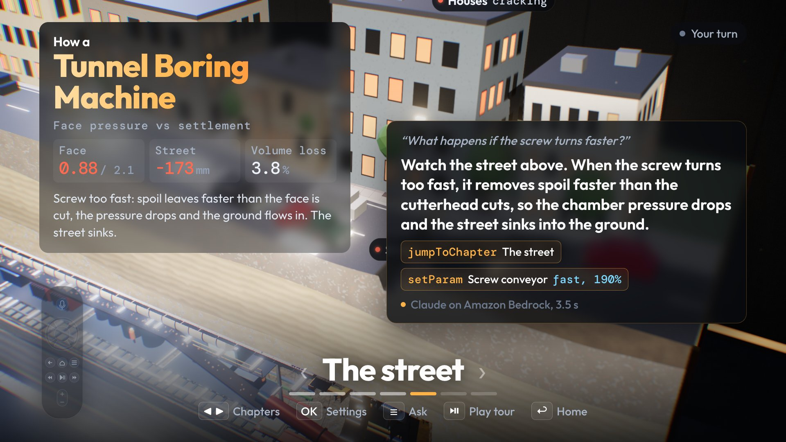

# Megastructures TV

Interactive engineering films for Fire TV. Pick a machine (a tunnel boring machine under a street, Starship above the clouds, a tsunami hitting a coast), move through its chapters with the D-pad, and press the Ask button: "What happens if the screw turns faster?" Claude on Amazon Bedrock answers out loud and changes the live 3D simulation, so the street above the tunnel actually sinks. Kids ask why, and the TV shows them.



Entry for the Build, Ship, Shape Amazon Developer Hackathon: Fire TV track, plus the AWS Builder and Open Source mini challenges.

## New in the hackathon window vs what existed before

The three physics scenes (tunnel boring machine, Starship, tsunami) existed before as separate browser pages with mouse controls. Everything below was built during the hackathon:

| New | Where |
|---|---|
| Fire OS app: Android Studio project, Kotlin, Leanback launcher, full screen WebView with WebGL, remote key bridge, `SpeechRecognizer`, `TextToSpeech` | `android/` |
| 10 foot UI: home row with posters, D-pad focus engine, chapters on Left and Right with the chapter name large at the bottom, a settings drawer that reaches every control with five buttons, 5% safe area, no text under 28 px at 1080p | `tv/src/shell/` |
| Voice question loop: Ask overlay (Web Speech API, native bridge, suggested questions, typed fallback), answer service calling Claude on Amazon Bedrock with three tools (`jumpToChapter`, `setParam`, `explain`), validation against the live ranges on screen, animated changes, spoken and captioned answers | `tv/src/shell/`, `server/` |
| TV performance mode (`?tv=1`): dynamic resolution, no MSAA, smaller shadow maps, a fixed light budget, lower ray march steps, a coarser tsunami terrain, a frame rate overlay | `packages/megastructures-engine/src/tv/quality.ts`, the three `main.ts` files |
| Open source engine: the scene engine split out, de-branded, with a TV input kit, docs and an example, MIT | `packages/megastructures-engine/` |
| AWS path: Lambda handler, SAM template (API Gateway, Lambda, S3, IAM for Bedrock and Polly), Polly speech adapter | `server/lambda.mjs`, `infra/template.yaml`, `server/tts.mjs` |

What was copied in: the three scenes' models, physics and chapter scripts (`tv/src/sims/`), and the shared material, geometry and post processing code that now lives in the engine package.

## Platform decision

I researched (15 minute time box, Amazon developer docs) how to ship a WebGL app to Fire TV in 2026 and how to run it without hardware on a Mac:

- **Fire OS app (Android APK with a WebView): chosen.** It runs on every Fire TV Stick in use today. Amazon documents the web key codes for Fire TV remotes. For testing without a device, Amazon's own guidance is an Android TV emulator image (Android 11, API 30, for Fire OS 8).
- **Vega OS (React Native for Vega plus the Vega WebView): not built yet.** Vega SDK 0.24 ships a WebView based on Chromium 144, and the Vega Virtual Device runs on Apple Silicon Macs. But the WebView guide does not say whether WebGL is supported, so a Three.js app could not be confirmed. Nothing I found said Vega is required for the hackathon.

Evidence, links and the rest of the friction are in [FRICTION_LOG.md](FRICTION_LOG.md).

## Run it

Needs Node 20 or newer.

```bash
npm install
cp .env.example .env        # add a Bedrock API key, or set VOICE_MODE=mock to run without AWS
npm run dev                 # API on http://127.0.0.1:8302, TV app on http://127.0.0.1:5302
```

Open http://127.0.0.1:5302/ in Chrome at full screen. Add `?tv=1` for TV performance mode, `?debug=1` for the frame rate overlay and `?remote=1` for the on screen remote. If `npm run dev` stops on your machine, run the two halves in two terminals: `npm run server` and `npm run dev:tv`.

### Remote and keyboard

| Action | Fire TV remote | Keyboard | Web keyCode / Android KeyEvent |
|---|---|---|---|
| Move, change chapter, change a setting | D-pad | Arrow keys | 37 to 40 / `KEYCODE_DPAD_*` (19 to 22) |
| Select, open settings | Select | Enter | 13 / `KEYCODE_DPAD_CENTER` (23) |
| Back: close, then home, then exit | Back | Escape or Backspace | `KEYCODE_BACK` (4), forwarded by the shell |
| Ask a question | Menu | M or V | `KEYCODE_MENU` (82) or `KEYCODE_SEARCH` (84), forwarded by the shell |
| Play or pause the guided tour | Play/Pause | Space | 179 / `KEYCODE_MEDIA_PLAY_PAUSE` (85) |
| Previous / next chapter | Rewind / Fast forward | , and . | 227, 228 / 89, 90 |
| Show or hide the story panel | Up | Up | |

The microphone button on a Fire TV voice remote belongs to Alexa: Amazon documents that apps cannot intercept it. So Menu is the Ask button. The page also listens for `window.MegaTV.key(name)`, `window.MegaTV.onVoice(text)`, `onVoicePartial` and `onVoiceError`, which is how the Android shell talks to it.

## How the voice loop works

```
 Fire TV remote ──Menu──▶ Fire OS shell (Kotlin) ──SpeechRecognizer──▶ text
        │ D-pad (DOM key events)       │ window.MegaTV.onVoice(text)
        ▼                              ▼
 ┌────────────────────────────────────────────────────────────┐
 │ TV app (WebView): Three.js scene + 10 foot shell            │
 │ snapshot = { sim, question, chapter, chapters, controls     │
 │              with live min/max/step/options, readings }     │
 └───────────────┬────────────────────────────────▲───────────┘
                 │ POST /api/ask                  │ { say, actions[] }
                 ▼                                │
 ┌──────────────────────────────┐   validate: known ids, clamp to range,
 │ Answer service (Node today;  │   snap to step, match options
 │ same handler for AWS Lambda  │──────────────────────────────┘
 │ behind API Gateway)          │
 └───────────────┬──────────────┘
                 │ Converse API, tools, toolChoice: any
                 ▼
 Amazon Bedrock: Claude Sonnet 4.5 ── jumpToChapter(sim, chapter)
                                       setParam(sim, param, value)
                                       explain(text)
 Speech out: speechSynthesis in the page, TextToSpeech in the shell, or Amazon Polly (TTS_PROVIDER=polly)
```

- The page sends the live state with every question, so the model always sees the real ranges (for example `screw: number from 0.3 to 2.2, now 1`) and the readings on screen. The system prompt adds what each parameter means physically (from `tv/src/catalog.json`).
- Claude answers with tool calls in one round trip. The server checks each one: unknown parameters and chapters are dropped, numbers are clamped and snapped, choices are matched by value or label. The page applies the jump first, then animates each slider from the value the viewer last saw.
- The answer card names the tool calls and the source: "Claude on Amazon Bedrock, 3.5 s", "Recorded ... replayed" or "Offline keyword rules (no AI)".
- `VOICE_MODE=ask` calls Bedrock for every question. `replay` answers from `server/recordings/` (real Bedrock answers saved with `RECORD=1`). `mock` uses keyword rules and never claims to be AI.

These questions were run for real against Bedrock through the UI and change the simulation as described:

| Film | Question | What Claude did |
|---|---|---|
| Tunnel Boring Machine | What happens if the screw turns faster? | `jumpToChapter street`, `setParam screw 1.9`: the street sinks (about -170 mm, drawn 20x) |
| Tsunami | Can a wall stop it? | `jumpToChapter wall`, `setParam wall 45`: run-up falls from 33 m to 0 m |
| Starship | When does the top part come off? | `jumpToChapter staging`: hot staging plays |
| Starship | What's inside the rocket? | `jumpToChapter tanks`, `setParam view cut` |
| Tunnel Boring Machine | What if we dig through granite? | read that the face chapter is already in granite and explained the slow advance |

## TV performance mode: before and after

`npm run perf` (with `npm run dev` running) loads each film with and without `?tv=1` in headless Chromium at 1920x1080 with vsync off, warms up for 5 s and counts frames for 10 s. Results from this machine (Apple Silicon laptop GPU, not a Fire TV Stick), from `output/perf.json`:

| Film (chapter) | Mode | fps | p95 frame | draw calls | triangles |
|---|---|---|---|---|---|
| Tunnel Boring Machine (street) | desktop | 35 | 55.9 ms | 303 | 478k |
| Tunnel Boring Machine (street) | TV mode | 56 | 37.0 ms | 373 | 483k |
| Starship (climb) | desktop | 22 | 36.9 ms | 248 | 5954k |
| Starship (climb) | TV mode | 70 | 13.8 ms | 248 | 5954k |
| Tsunami (city) | desktop | 41 | 44.3 ms | 66 | 1980k |
| Tsunami (city) | TV mode | 67 | 26.8 ms | 66 | 1234k |

What TV mode changes:

- **Dynamic resolution:** `ResolutionGovernor` aims for 33 ms (30 fps) and moves the render scale between 50% and 100%. It drops fast and climbs slowly. On this laptop it stayed at 100%, so the gains above come from the items below. On a stick it will also lower the resolution.
- **No MSAA** on the HDR scene buffers (4 samples before).
- **Shadow maps:** 1024 instead of 4096 (TBM and tsunami studio key light) and 2048 (Starship sun).
- **Light budget:** a fixed number of lights of each kind (spot 3, shadow casting spot 1, point 2, or 4 for Starship's tank lights) through `RenderBudget`, so the count never changes and no shader recompiles.
- **Level of detail:** cloud ray march steps 34 to 16 and plume steps 30 to 16 on Starship. Tsunami terrain grid 420 to 210 and sea 380 to 190 cells per side (1980k to 1234k triangles). The depth of field gather (40 taps per pixel) is off on TBM and tsunami.
- Starship's 5.9M triangles include the shadow and environment passes. Its 39 engines were already a light 30k triangle model, so TV mode does not change its geometry. That remains the biggest risk on a real stick.

Turn TV mode on and off from the home row settings or the settings drawer, or with `?tv=1` / `?tv=0`. The Android shell turns it on by default.

## Fire OS app (android/)

A complete Android Studio project: Kotlin, `minSdk 25` (Fire OS 6), Leanback launcher category plus a 320x180 banner, `android.hardware.touchscreen required=false`, a full screen hardware accelerated WebView (JavaScript, DOM storage, autoplay without a gesture), a key bridge, `SpeechRecognizer` with a `RECORD_AUDIO` prompt and `TextToSpeech` for answers. The web build is bundled in `assets/www` and served through `WebViewAssetLoader`.

**Status: written by hand and not compiled or run.** The build machine has no Java, Android SDK or adb. Expect small fixes on the first Gradle sync.

Build and sideload:

```bash
npm run build:android                 # vite build, then copy dist/ into android/app/src/main/assets/www
# open android/ in Android Studio (Koala or newer), let it sync, it creates the Gradle wrapper
# or, with Gradle 8.7 installed:  cd android && gradle wrapper && ./gradlew assembleDebug

# Android TV emulator (Amazon's suggestion for Fire OS 8): Device Manager, TV, "Android TV (1080p)", API 30
adb install -r android/app/build/outputs/apk/debug/app-debug.apk

# Fire TV Stick: Settings, My Fire TV, Developer options, ADB debugging on (and apps from unknown sources)
adb connect <fire-tv-ip>:5555
adb install -r android/app/build/outputs/apk/debug/app-debug.apk
adb shell am start -n tv.megastructures.app/.MainActivity
adb exec-out screenrecord --bit-rate 8000000 /sdcard/megatv.mp4    # device screen capture for the video
```

The app needs the answer service. In `android/gradle.properties`, `megatvApi` defaults to `http://10.0.2.2:8302` (your Mac as seen from the emulator). On a Fire TV Stick use your Mac's LAN address and run the server with `npm run server`. Once deployed, use the API Gateway URL. Set `megatvUrl=http://10.0.2.2:5302/` to load the UI live from the dev server instead of the bundled copy.

## AWS deployment (written, not deployed)

`infra/template.yaml` is an AWS SAM template: an HTTP API (API Gateway) in front of one Lambda (`server/lambda.handler`, the same routes as the local server), IAM for `bedrock:InvokeModel` and `polly:SynthesizeSpeech`, the Bedrock API key read from Secrets Manager, and a private S3 bucket for the film catalog and posters. With AWS credentials:

```bash
sam build -t infra/template.yaml
sam deploy --guided --parameter-overrides BedrockApiKeySecretArn=arn:aws:secretsmanager:...
```

None of this was deployed. The build machine had a Bedrock API key, which works only for Bedrock runtime, and no SigV4 credentials for Lambda, S3, Polly or CloudFormation. The Lambda handler is unit tested locally with a fake API Gateway event. The Polly adapter (`server/tts.mjs`) needs `@aws-sdk/client-polly` (included in the Lambda Node 20 runtime) and was not run.

## Tests

```bash
npm run test:unit     # 11 tests: tool validation, clamping, prompt content, mock answers, Lambda routes
npm run typecheck     # the TV app and the engine package
npm run perf          # the performance table above (needs npm run dev)
```

The end to end checks I ran by hand on this machine, through the real UI in headless Chromium: D-pad chapter changes, the settings drawer (focus, scroll, change values), Back to home, and the three plan questions against live Bedrock with the resulting simulation state read back from the page.

## The film

`npm run record:answers` asks the demo questions through the real UI with the API in record mode (`RECORD=1 VOICE_MODE=ask npm run server`) and saves the Bedrock answers. `npm run film` then records `output/megastructures-tv-screen.mp4` (1920x1080, 30 fps, 2:21.5, silent) frame by frame and writes poster stills to `output/stills/`. Remote presses go through `window.MegaTV.key`, the same bridge the Android shell uses. Answers are those recorded Bedrock responses, replayed. The thinking pause in the film is each answer's real latency.

**The final video also needs a shot of the app on a Fire TV device or the Android TV emulator, which the user adds** (see DEMO_SCRIPT.md for where it goes). The mp4 is not committed (size). Re-create it with the commands above.

## Project layout

```
tv/                       the TV web app (Vite, TypeScript, Three.js)
  index.html              home row
  tbm.html starship.html tsunami.html
  card.html               explainer cards used in the film
  src/shell/              10 foot shell: focus, drawer, ask overlay, answers, speech, remote overlay
  src/sims/               the three scenes (copied in, de-branded, wired to the shell)
  src/catalog.json        films, parameter meanings, suggested questions (read by the server too)
server/                   answer service: Bedrock Converse, validation, record/replay/mock, Polly adapter, Lambda entry
android/                  Fire OS app (Kotlin, Leanback, WebView)
packages/megastructures-engine/   the open source engine (MIT), with its own README and example
infra/template.yaml       AWS SAM template (not deployed)
scripts/                  dev runner, perf, posters, answer recorder, film recorder
```

## Limitations

- **Not run on a Fire TV device or emulator.** The Android project has never been compiled. WebGL performance on a real stick is unmeasured. The numbers above are from a laptop GPU.
- Speech recognition on Fire OS is unverified. If the device has no recogniser, the Ask overlay falls back to suggested questions and typing.
- Voice answers take 3 to 4 s (Bedrock round trip). There is no streaming yet.
- Lambda, API Gateway, S3 and Polly are code and IaC only, not deployed or run. Speech in the demo is the browser's speechSynthesis. The film is silent.
- The film uses recorded Bedrock answers (real calls, replayed). Live mode calls Bedrock for every question.
- Fusion Plant, Particle Collider and Metal Printer are "coming soon" tiles, not ported.
- The simulations are simplified models built on public figures (Peck 1969 settlement trough, Wells and Coppersmith rupture scaling, a simplified Starship flight model). They are for explaining ideas, not for engineering decisions.
- Vega OS is not supported yet (see Platform decision).
- `npm run dev` runs both servers as child processes. On my machine an outside process killed long running Node processes twice, so the README also gives the two separate commands.

## License and attribution

MIT, see [LICENSE](LICENSE). The engine package is MIT as well.

- [three.js](https://threejs.org) (MIT), [Vite](https://vitejs.dev) (MIT), [TypeScript](https://www.typescriptlang.org) (Apache 2.0).
- Fonts: Outfit and DM Mono, SIL Open Font License 1.1, self hosted.
- AndroidX WebKit, AppCompat and Leanback (Apache 2.0).
- Physics references: R. B. Peck (1969) for tunnel settlement troughs; Wells and Coppersmith (1994) for rupture size from magnitude; public figures for Starship V3 dimensions and the 2011 Tohoku earthquake (Mw 9.1, 40.5 m maximum run-up).
- Claude by Anthropic, used through Amazon Bedrock.
